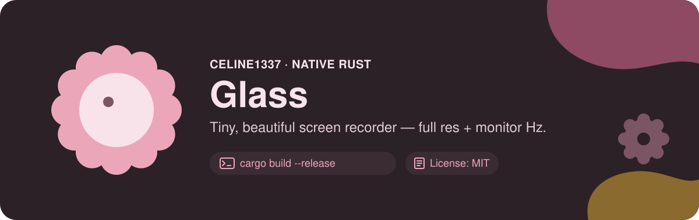
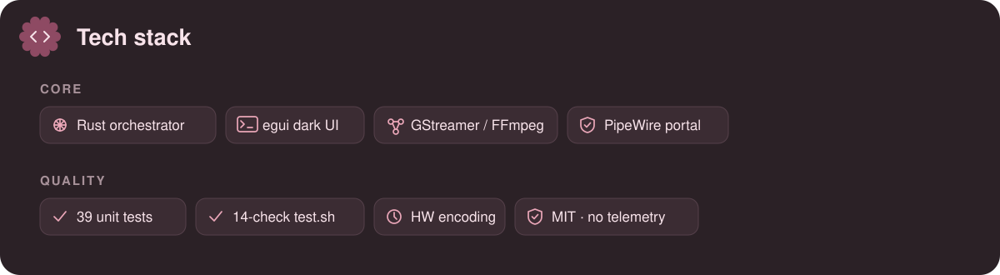

<p align="center">
  
</p>
<p align="center">
  <a href="https://github.com/Celine1337/glass/releases"></a>
  <a href="https://flatpak.github.io/xdg-desktop-portal/docs/"></a>
  <a href="LICENSE"></a>
</p>


**Glass** is a tiny, beautiful screen recorder for Linux and Windows. One window, one button: it captures your screen at its **native resolution** and your **monitor's refresh rate**, encodes H.264 to an MP4, and gets out of the way. No subscriptions, no accounts, no telemetry, no cloud — just a free, open (MIT) native app.

The trick to staying light: the Rust process is only an **orchestrator and a UI**. It never touches a video frame. Capture and encoding run entirely in a native child process — GStreamer on Linux, FFmpeg on Windows — preferably on a **hardware encoder**, so CPU and RAM stay near zero while you record. Glass itself is a single small binary with a calm, minimal dark interface.


- **Full resolution + monitor Hz** — reads your primary display via `display-info` and captures at exactly that size and refresh rate (shown live in the UI chip, e.g. `3840×2160 · 144 Hz`).
- **Hardware-first encoding** — auto-detects and prefers `vah264enc` / `nvh264enc` (GStreamer) or `h264_nvenc` / `h264_amf` / `h264_qsv` (FFmpeg), falling back to tuned `x264enc` / `libx264`.
- **Wayland done right** — uses the `xdg-desktop-portal` ScreenCast portal via `ashpd`, hands the PipeWire remote to GStreamer at fd 3, and records the monitor you pick at its real native rate (fractional refresh like 59.94/60.008 Hz included). X11 uses `ximagesrc`; Windows uses `gdigrab` by default, with Desktop Duplication (`ddagrab`, zero-copy D3D11) opt-in via `GLASS_WINDOWS_BACKEND=ddagrab`.
- **Graceful stop** — SIGINT/EOS for GStreamer, `q` for FFmpeg, so the MP4 muxer finalizes a playable file every time.
- **A genuinely minimal UI** — one rose record button, a tabular timer, a resolution chip, a folder row. Dark, calm, premium; keyboard driven (`Space` record/stop, `Esc` stop) with reduced-motion support and ~0 idle CPU.
- **Tiny footprint** — the orchestrator never decodes a frame; the heavy lifting is delegated to the native backend.
- **Tested** — 50 Rust unit tests on the pure helpers plus a 14-check `test.sh` (synthetic encoding only — your real screen is never touched). If a capture ever fails, the backend's stderr is kept in a `.log` next to the recording and the error message tells you what happened.




**Linux runtime deps:** GStreamer 1.0 with the `pipewiresrc`, `videoconvert`, `x264enc` (or `vah264enc`/`nvh264enc`), `mp4mux` plugins, and PipeWire (for Wayland). On Debian/Ubuntu:

```bash
sudo apt install gstreamer1.0-tools gstreamer1.0-plugins-base \
     gstreamer1.0-plugins-good gstreamer1.0-plugins-bad pipewire
```

**Windows:** a static `ffmpeg.exe` is bundled next to `glass.exe` in the release zip (CI downloads it); nothing else to install.

Build from source (Rust 1.85+):

```bash
git clone https://github.com/Celine1337/glass.git
cd glass
./build.sh                 # cargo build --release -> target/release/glass
./target/release/glass
```


Launch `glass`, press the rose button (or `Space`) to record, press again (or `Esc`) to stop. Files land in `~/Videos/Glass` as `glass-YYYYmmdd-HHMMSS.mp4`; change the folder from the UI.

```text
Space   record / stop
Esc     stop
```

Headless / scripting helpers (no capture, no window):

```bash
glass --version                                  # print version
glass --probe                                    # display + encoder info as JSON
glass --dump-pipeline wayland 3840 2160 144 out.mp4   # print the native capture command
```

> **Honest note:** the Wayland portal path is fully implemented and compiles, but end-to-end capture needs a real desktop session to verify (the portal shows a screen picker). Encoding is verified in CI with synthetic sources only.


MIT — see [LICENSE](LICENSE).