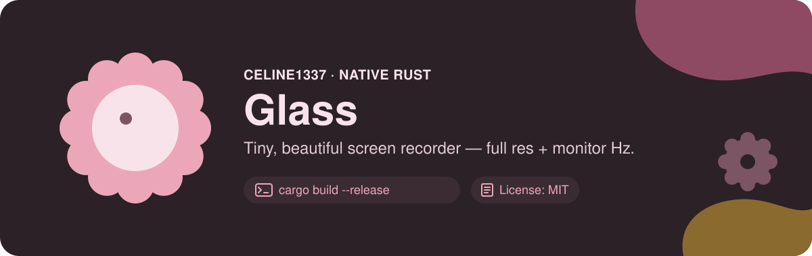
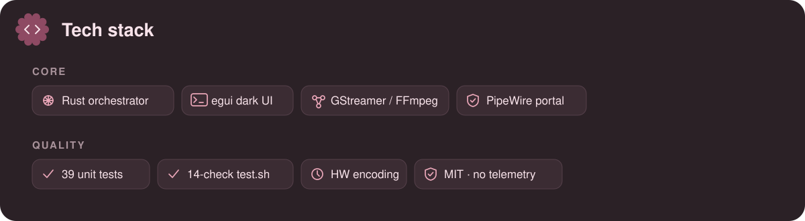

<p align="center">
  
</p>
<p align="center">
  <a href="https://github.com/Celine1337/glass/releases"></a>
  <a href="https://flatpak.github.io/xdg-desktop-portal/docs/"></a>
  <a href="LICENSE"></a>
</p>


**Glass** — маленькая и красивая программа для записи экрана под Linux и Windows. Одно окно, одна кнопка: она пишет экран в **родном разрешении** и на **герцовке монитора**, кодирует H.264 в MP4 и не мешает. Без подписок, без аккаунтов, без телеметрии и облака — просто бесплатное открытое (MIT) нативное приложение.

Секрет лёгкости: процесс на Rust — это только **оркестратор и интерфейс**. Он никогда не трогает видеокадры. Захват и кодирование целиком идут в нативном дочернем процессе — GStreamer на Linux, FFmpeg на Windows — желательно на **аппаратном кодировщике**, поэтому CPU и RAM почти нулевые во время записи. Сам Glass — один небольшой бинарник со спокойным минималистичным тёмным интерфейсом.


- **Полное разрешение + герцовка** — читает основной монитор через `display-info` и пишет ровно в этом размере и на этой частоте (видно в чипе интерфейса, напр. `3840×2160 · 144 Hz`).
- **Аппаратное кодирование в приоритете** — сам находит и предпочитает `vah264enc` / `nvh264enc` (GStreamer) или `h264_nvenc` / `h264_amf` / `h264_qsv` (FFmpeg), с откатом на тюнингованные `x264enc` / `libx264`.
- **Wayland как надо** — портал ScreenCast (`xdg-desktop-portal`) через `ashpd`, PipeWire-remote передаётся GStreamer в fd 3, пишется выбранный монитор. На X11 — `ximagesrc`; на Windows — Desktop Duplication (`ddagrab`) с откатом на `gdigrab`.
- **Аккуратная остановка** — SIGINT/EOS для GStreamer, `q` для FFmpeg, поэтому MP4 всегда финализируется в играбельный файл.
- **Честно минимальный UI** — одна розовая кнопка записи, табличный таймер, чип разрешения, строка папки. Тёмный, спокойный, премиальный; управление с клавиатуры (`Space` запись/стоп, `Esc` стоп), поддержка reduced-motion и ~0 CPU в простое.
- **Маленький след** — оркестратор не декодирует ни кадра; вся тяжёлая работа уходит нативному бэкенду.
- **Тесты** — 39 юнит-тестов Rust на чистых хелперах плюс `test.sh` на 14 проверок (только синтетическое кодирование — реальный экран не трогается).




**Зависимости Linux:** GStreamer 1.0 с плагинами `pipewiresrc`, `videoconvert`, `x264enc` (или `vah264enc`/`nvh264enc`), `mp4mux`, и PipeWire (для Wayland). В Debian/Ubuntu:

```bash
sudo apt install gstreamer1.0-tools gstreamer1.0-plugins-base \
     gstreamer1.0-plugins-good gstreamer1.0-plugins-bad pipewire
```

**Windows:** статический `ffmpeg.exe` лежит рядом с `glass.exe` в zip релиза (CI скачивает его); больше ничего не нужно.

Сборка из исходников (Rust 1.85+):

```bash
git clone https://github.com/Celine1337/glass.git
cd glass
./build.sh                 # cargo build --release -> target/release/glass
./target/release/glass
```


Запустите `glass`, нажмите розовую кнопку (или `Space`) для записи, ещё раз (или `Esc`) для остановки. Файлы сохраняются в `~/Videos/Glass` как `glass-YYYYmmdd-HHMMSS.mp4`; папку можно сменить в интерфейсе.

```text
Space   запись / стоп
Esc     стоп
```

Служебные команды (без захвата и без окна):

```bash
glass --version                                  # версия
glass --probe                                    # дисплей + кодировщики в JSON
glass --dump-pipeline wayland 3840 2160 144 out.mp4   # нативная команда захвата
```

> **Честно:** путь портала Wayland полностью реализован и компилируется, но сквозной захват требует реальной сессии рабочего стола для проверки (портал показывает выбор экрана). Кодирование проверяется в CI только на синтетических источниках.


MIT — см. [LICENSE](LICENSE).